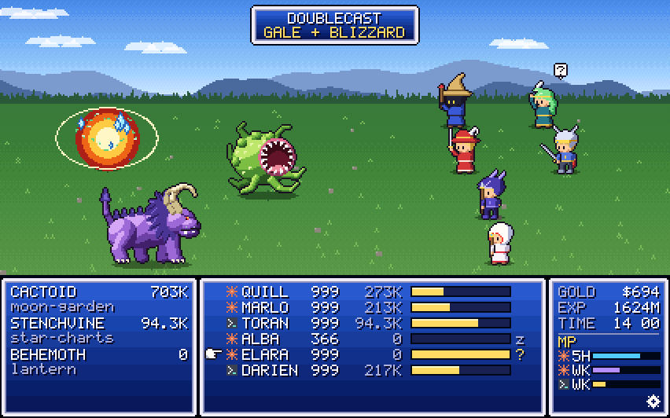
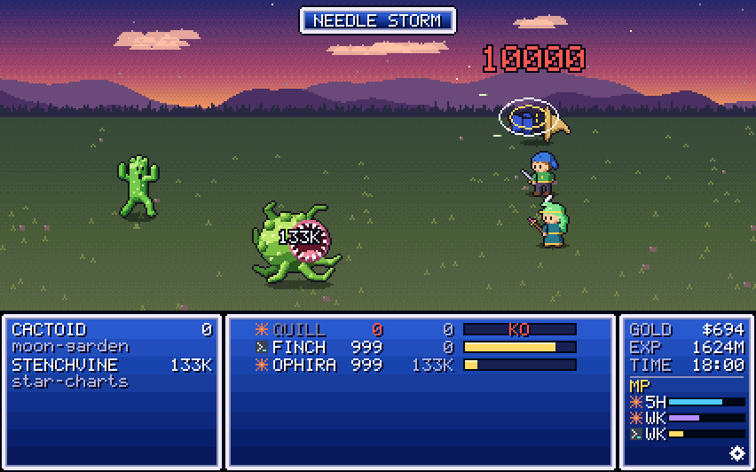
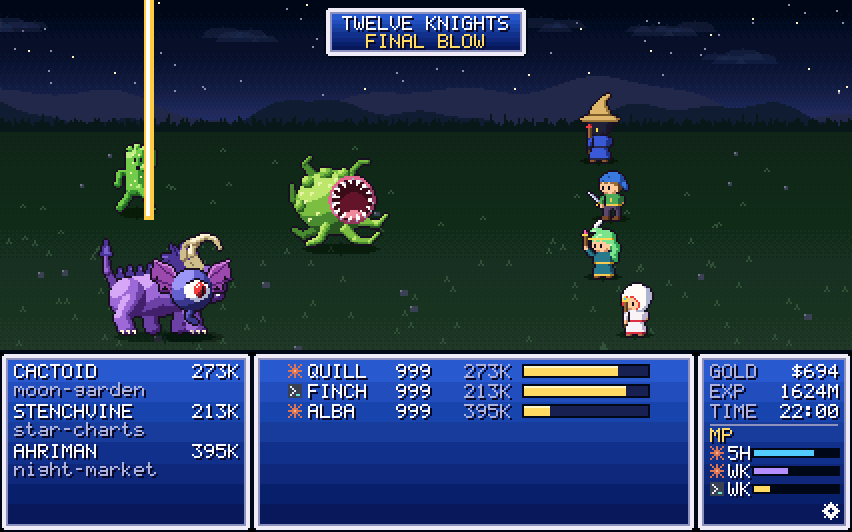
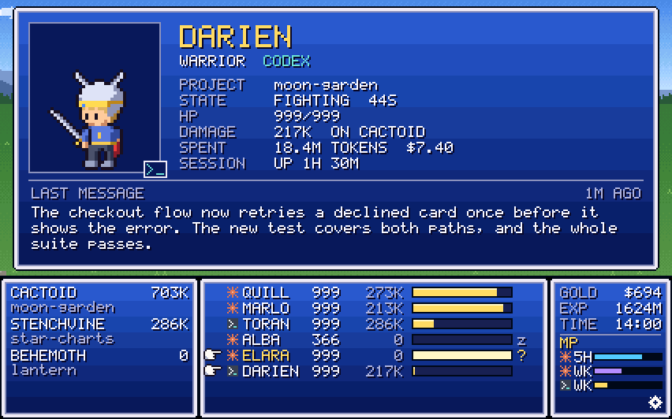

<div align="center">

# ⚔️ Token Fantasy

**Your AI coding agents as a 16-bit JRPG battle party, and your projects as the monsters they fight.**

Every Claude Code and Codex session running on your machine joins the party. They swing at their project for the tokens they burn, cast a spell for every tool call, get hit while they sit idle, and raise a hand when they need you.




</div>

> [!IMPORTANT]
> **macOS: need a Mac tester.** macOS support is written (sessions found through libproc and sysctl, sounds through `afplay`, terminals brought up with `open -a kitty`) and type-checks, but nobody has run it on a Mac yet. If you have one, please build it, run `token-fantasy --print` next to a Claude Code or Codex session, then the window, and open an issue with what you see, good or bad.

## What you're looking at

Each session is a hero. Claude Code sessions are **mages** (Sorcerer, Cleric, Spellsword, Summoner) and Codex sessions are **fighters** (Warrior, Thief, Monk, Lancer). A new session takes the class its side has least of, and its name is picked at random from that class's list. Each project gets a **monster**: the project is the session's git repository, known by its remote, so clones, worktrees and subfolders of one repository all fight the same monster.

| Your agent… | In the battle… |
|---|---|
| **burns tokens** | its time gauge fills, and every 8 s it attacks its monster. The damage is the number of tokens it burned since then. |
| **calls a tool** | a mage casts a spell: Bash **FIRE**, Edit **BLIZZARD**, Read **SCAN**, Web **GALE**, TodoWrite **PROTECT**, anything else **THUNDER**. A subagent gets the class special: **FLARE**, **HOLY**, **DOUBLECAST** or **SUMMON**. A fighter answers every tool call with its own special: **CROSS CUT**, **STEAL**, **CHI BURST** or **JUMP**. |
| **waits for you** | raises a hand with `!` for a permission prompt or `?` for a question, and a chime plays |
| **sits idle** | its monster hits it about every 30 s, and its HP drains as the idle time grows. At 10 minutes the monster uses its finisher (NEEDLE STORM, CATACLYSM, …) and the hero is knocked out. |
| **gets back to work** | **CURE** if it was hurt, **PHOENIX PLUME** if it was knocked out |

<div align="center">

<br><sub>Idle for ten minutes: the Cactoid's NEEDLE STORM.</sub>
</div>

Up to four monsters are on the field at once; they go to the projects with the most sessions. A busier fifth project makes the quietest monster **flee**, and a session whose project has no monster fights the nearest one. When a project's last session ends, a hero finishes its monster with the class's **final blow** (THOUSAND CUTS, METEOR, TWELVE KNIGHTS, …), and the monster is **DEFEATED** to the victory fanfare. The field holds eight heroes in two columns of four; any more wait off the field behind a `+N WAIT` tab.

<div align="center">

<br><sub>A project's last session ended: TWELVE KNIGHTS.</sub>
</div>

The windows along the bottom show:

- **Monster window:** each monster, its project and the damage it has taken.
- **Party window:** each hero's HP, the damage it has done, and its time gauge. A `z` marks a hero that's idle, `!` or `?` one that's waiting, and `KO` one that's knocked out.
- **Info window:** **GOLD** is this month's spend at the vendors' list prices, **EXP** this month's tokens, Claude and Codex together. If you're on a subscription, that measures how much you've used, not what you've been billed. **MP** is the quota you have left: Claude's 5-hour and weekly windows, and Codex's weekly one.

The sky follows the clock, from day to dusk to night.

**Click a hero** (or its row) to open its status card: its job, its project, its state and for how long, its HP, its damage, the session's spend and age, and the opening of its last message. You also see the question it's asking, or the tool call it wants approved. If the session runs in kitty, clicking the portrait brings its terminal window to the front. **Click the info window** to open the config window, for fullscreen, sound, and the pace. At a **Wait** pace, monsters spare a hero that's waiting on you. At an **Active** pace, they hit it too.

<div align="center">

</div>

## Getting started

You need [Rust](https://rustup.rs) 1.88 or newer and a C compiler (SQLite is built in), on a Linux Wayland or X11 desktop, or on macOS (untested, see above; `xcode-select --install` gives you the C compiler). Optional extras:

- `curl`, for the MP bars.
- `pw-play`, `paplay` or `aplay`, for the sounds (macOS has `afplay` built in).
- kitty with remote control (`listen_on` in `kitty.conf`), to bring a session's terminal up from its card; on Linux it is raised with Hyprland's `hyprctl`, on macOS with `open -a kitty`.

```sh
cargo build --release
./target/release/token-fantasy
```

| Command | |
|---|---|
| `token-fantasy` | the live battle |
| `token-fantasy --demo` | a made-up battle that shows the moves, no agents needed |
| `token-fantasy --print` | list the live sessions, their tool calls, this month's usage and the quota in the terminal, then exit |
| `token-fantasy --scale N` | open at N × 426×266 (default 3) |
| `--mute`, `--unmute`, `--volume N`, `--pace wait\|active` | change the saved settings |

| Key | |
|---|---|
| `1` – `6` | resize the window to that many times 426×266 |
| `f` / `F11` | fullscreen |
| `Esc` | close the card or the config window, else leave fullscreen |
| `m` | mute or unmute |
| `q` | quit |

The battle is drawn at 426×266 and scaled by the largest whole number that fits the window, so the pixels stay crisp; the rest of the window is letterboxed. Only what changes on screen is repainted. The window's Wayland app id and X11 class are both `token-fantasy`, for window rules.

## How it knows

Everything except the quota is read from your own disk.

| | Where it looks |
|---|---|
| **Claude Code** | `~/.claude/sessions/<pid>.json` for the live sessions and their state (a session counts only while its process is the one that wrote the file). Each session's transcript under `~/.claude/projects/` gives its tool calls, its last message and what it is waiting on. |
| **Codex** | running `codex` processes, the rollout logs they hold open (including the threads of the remote-control daemon), and `~/.codex/state_5.sqlite` as a fallback. Codex logs no approval prompts, so a fighter never raises a hand. |
| **Projects** | the git repository around each session's directory and its remote, read from `.git/config` directly; no `git` command is run. |
| **Damage, GOLD, EXP** | every transcript written this month. Each API response carries its token counts. A session's damage is what it burned since Token Fantasy started. |
| **MP** | the usage endpoints the CLIs use for their own status displays, called with the OAuth tokens they keep on disk. Each reading is fetched at most every 3 minutes and passed to `curl` on stdin, never on a command line. This is the only network access. |

`CLAUDE_CONFIG_DIR`, `CODEX_HOME`, `XDG_CACHE_HOME`, `XDG_CONFIG_HOME` and `XDG_RUNTIME_DIR` are honoured. Sessions run remotely (from claude.ai or the phone) stay out of the battle.

Token Fantasy writes only to these folders:

- `~/.cache/token-fantasy-desktop/` (macOS: `~/Library/Caches/token-fantasy-desktop/`): the usage and quota caches.
- `~/.config/token-fantasy-desktop/settings.json` (macOS: `~/Library/Application Support/token-fantasy-desktop/`): mute, volume and pace.
- `$XDG_RUNTIME_DIR/token-fantasy-desktop/`: the sounds.

## Under the hood

```
design/                 the art and the design's battle engine, as pixel strings and plain JS
tools/gen_art.mjs       turns it into src/art.rs and src/art.bin
src/scene/              the battle: rules and cast (mod.rs), effects (fx.rs), field and windows (ui.rs)
src/gfx.rs              lines, discs, rings, blends, dithered sprites, a 5×7 font, the window frame
src/collect/            which sessions are live, their tool calls and last messages
src/feed.rs             sessions for the battle: projects, spend, damage; the --demo director
src/usage.rs            this month's tokens and list-price dollars, per transcript
src/quota.rs            the MP bars
src/sound.rs            the chimes and the fanfare, synthesized
src/app.rs              the window: winit + softbuffer, whole-number scaling, damage tracking
examples/preview.rs     battle scenarios rendered to PNG, no window needed
examples/screenshots.rs renders the images in this README
```

After changing the art in `design/`:

```sh
node tools/gen_art.mjs                         # regenerate the sprites, fields and font
cargo run --release --example screenshots      # refresh docs/*.png
```

## Names

The heroes, jobs, monsters and moves have names of their own, in the spirit of the 16-bit JRPGs that inspired it; Token Fantasy is not affiliated with any game or publisher.
